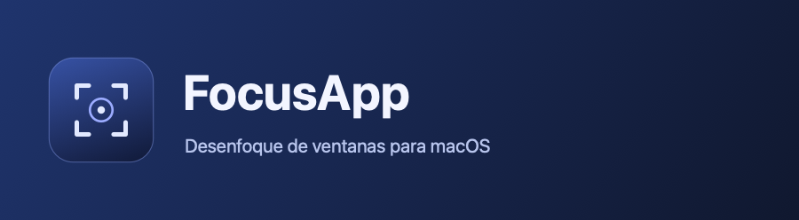

# FocusApp

FocusApp es una app gratuita de barra de menús para macOS. Mantiene nítidas las ventanas en las que trabajas y desenfoca en vivo el fondo, sin capturar la pantalla.

[](https://github.com/JuanCarlosAcostaPeraba/focusapp/releases/latest/download/FocusApp.dmg)
[](https://github.com/JuanCarlosAcostaPeraba/focusapp/releases/latest)
[English](README.en.md)



## Descargar e instalar

Requiere **macOS 14 o posterior**. El DMG incluye un binario universal para Apple Silicon e Intel.

1. Descarga [FocusApp.dmg](https://github.com/JuanCarlosAcostaPeraba/focusapp/releases/latest/download/FocusApp.dmg) y abre la imagen.
2. Arrastra **FocusApp** a **Aplicaciones** y ábrela desde allí.
3. Pulsa el icono de visor en la barra de menús y elige **Activar desenfoque**.

La versión pública lleva firma ad hoc y carece de notarización. Si macOS bloquea el primer inicio y confías en la descarga, cierra el aviso y busca **Abrir igualmente** en **Ajustes del Sistema → Privacidad y seguridad**. También puedes [compilar desde el código](#compilar-desde-el-código). [Instrucciones de Apple](https://support.apple.com/es-es/102445)

## Personalizar el foco

- En **Ajustes → Aspecto** elige mantener nítida la **ventana activa** o la **app activa**. Ajusta el desenfoque, el monocromo, el grano y el tinte, o usa los preajustes **Suave**, **Intenso** y **Solo tinte**.
- En **Pantallas** puedes aplicar el efecto en la pantalla que contiene la mayor parte de la ventana activa o en todas. Puedes incluir las miniaturas de Stage Manager en el desenfoque.
- En **Ajustes → Activación** puedes asignar un atajo global o activar el gesto de agitar el cursor.
- En **Exclusiones** puedes mantener nítidas las partes visibles de otras apps. Teleprompter viene incluido por defecto.
- En **Grupos** puedes vincular dos o más apps. Las ventanas visibles del grupo quedan nítidas al enfocar cualquiera de sus miembros.

Los ajustes se guardan localmente. FocusApp usa metadatos de ventanas para seguir el foco y no solicita permisos de Grabación de Pantalla ni de Accesibilidad.

Core Animation compone el desenfoque en vivo. FocusApp usa APIs privadas para el radio gaussiano y el monocromo. Si no están disponibles o está activado **Reducir transparencia**, usa el material de AppKit con un ajuste de opacidad.

## Compilar desde el código

Desde la raíz del repo, con Xcode 26 o posterior y sus herramientas seleccionadas:

```sh
./scripts/build-app.sh
open DerivedData/Build/Products/Release/FocusApp.app
```

Con [uv](https://docs.astral.sh/uv/getting-started/installation/) instalado, puedes generar el instalador y su suma SHA-256:

```sh
./scripts/build-dmg.sh
```

El instalador queda en `dist/FocusApp.dmg`. Consulta la [guía de publicación](docs/releasing.md) para preparar otra versión.

## Dar feedback

[Abre un issue](https://github.com/JuanCarlosAcostaPeraba/focusapp/issues/new) con la versión de FocusApp, la versión de macOS y los pasos que seguiste. Si el problema tiene que ver con el desenfoque, indica cuántos monitores usas y si Stage Manager está activo.
